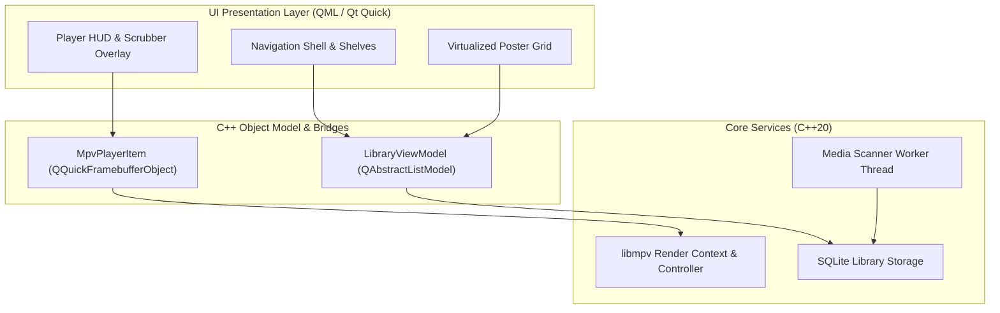

# localplex Architecture

This document describes the internal structure, threading model, and subsystem responsibilities of `localplex`. It is written to allow a new developer or contributor to understand the codebase and run the application in under ten minutes.

---

## 10-Minute Quickstart

### Prerequisites
- Linux (x86_64 or aarch64), macOS (Apple Silicon / Intel), or Windows 10/11
- CMake 3.22 or higher
- C++20 compiler: GCC 11+, Clang 13+, or MSVC 2019+
- Qt 6.5+ with QML and OpenGL modules
- libmpv 0.35+ (`mpv-devel` or `libmpv-dev`)
- SQLite 3.35+

### Build and Run (Linux)

```bash
# 1. Install dependencies on Debian/Ubuntu derivatives:
sudo apt-get install -y cmake ninja-build build-essential libmpv-dev libsqlite3-dev \
  qt6-base-dev qt6-declarative-dev qml6-module-qtquick qml6-module-qtquick-controls \
  qml6-module-qtquick-layouts qml6-module-qtquick-window

# On Arch Linux:
sudo pacman -S --needed cmake ninja base-devel mpv sqlite qt6-base qt6-declarative qt6-quickcontrols2

# 2. Configure build
cmake -B build -S . -DCMAKE_BUILD_TYPE=Debug

# 3. Build executable
cmake --build build -j$(nproc)

# 4. Launch localplex
./build/localplex
```

---

## High-Level Architecture

The application is structured into four primary decoupled layers:



---

## Subsystems

### 1. Embedded Video Engine (`src/player/`)
- Encapsulates `libmpv` using a `QQuickFramebufferObject` subclass (`MpvPlayerItem`).
- **Threading:** Qt Quick runs its rendering pass on a dedicated render thread. `MpvPlayerItem::Renderer` handles OpenGL context bindings and calls `mpv_render_context_render` straight into Qt's off-screen framebuffer object.
- Frame updates are signaled from mpv's internal event loop back to Qt's event loop via thread-safe queued signals.
- Audio and subtitle stream indexing, playback rate adjustment, and hardware decode configuration are orchestrated via C++ properties exposed directly to QML.

### 2. Library Storage & Database (`src/database/`)
- Manages an embedded SQLite database (`localplex.db`) located in standard XDG data directories (`$XDG_DATA_HOME/localplex/` on Linux).
- Stores media folder roots, parsed series, seasons, episodes, movies, watch progress, and custom user overrides.
- Never writes back into or touches the user's media directories.

### 3. Media Scanner & Parser (`src/scanner/`)
- Operates on a background worker thread (`QThreadPool` / `QThread`).
- Crawls registered filesystem directories, extracts filename heuristics (show title, season, episode), checks local companion `.nfo` or image sidecars, and synchronizes the SQLite catalog.
- Emits progress events to the UI without blocking the main event loop.

### 4. UI Shell & Virtualized Views (`src/qml/`)
- Written in Qt Quick (QML) adhering strictly to `docs/DESIGN.md`.
- Virtualized list and grid views instantiate delegates strictly for on-screen viewports, satisfying the memory and scrolling refresh-rate budget.
- Clean separation between player HUD controls and the active video render surface.

---

## Directory Layout

```
localplex/
├── assets/
│   ├── fonts/         # Bundled open-source typography (Inter)
│   └── icons/         # Custom geometric SVG icon set
├── docs/
│   ├── ARCHITECTURE.md # System breakdown and build instructions
│   ├── DECISIONS.md    # Architectural Decision Records & dependency log
│   └── DESIGN.md       # Visual design rules, typography, and motion tokens
├── src/
│   ├── main.cpp        # Entry point, Qt graphics API configuration
│   ├── player/         # libmpv QQuickFramebufferObject implementation
│   ├── database/       # SQLite schema and query manager
│   ├── scanner/        # File parser and directory scanner
│   └── qml/            # QML presentation components and player HUD
├── tests/
│   ├── fixtures/       # Freely-licensed test media patterns
│   └── unit/           # Parser and database unit tests
├── tools/
│   ├── bench/          # Cold start and memory budget benchmark scripts
│   └── git/            # Pre-commit privacy & secret checks
└── CMakeLists.txt      # Root build configuration
```
